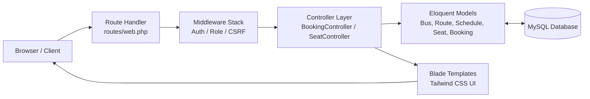
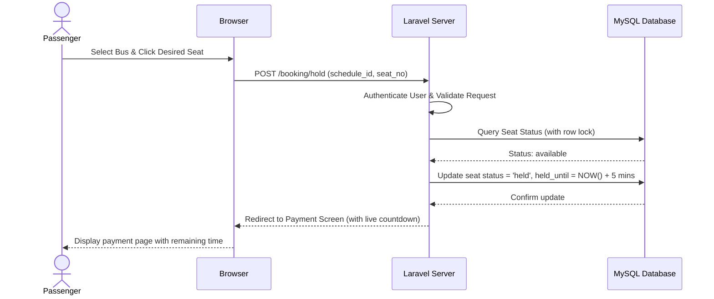
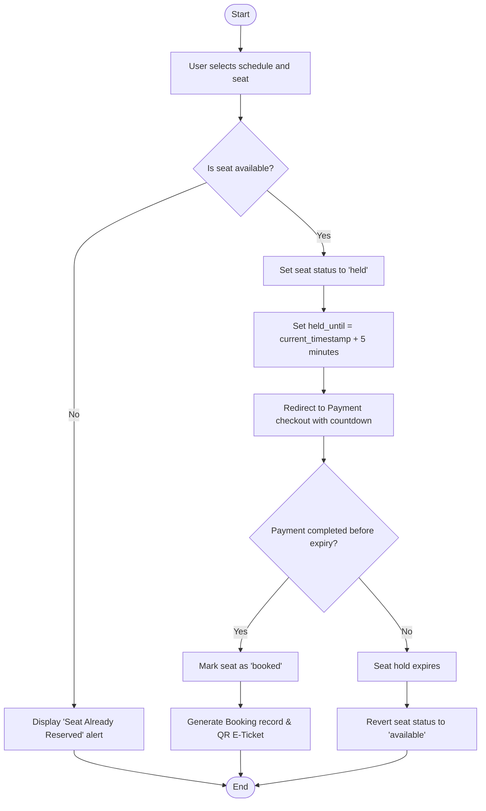
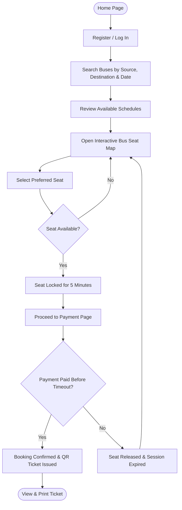
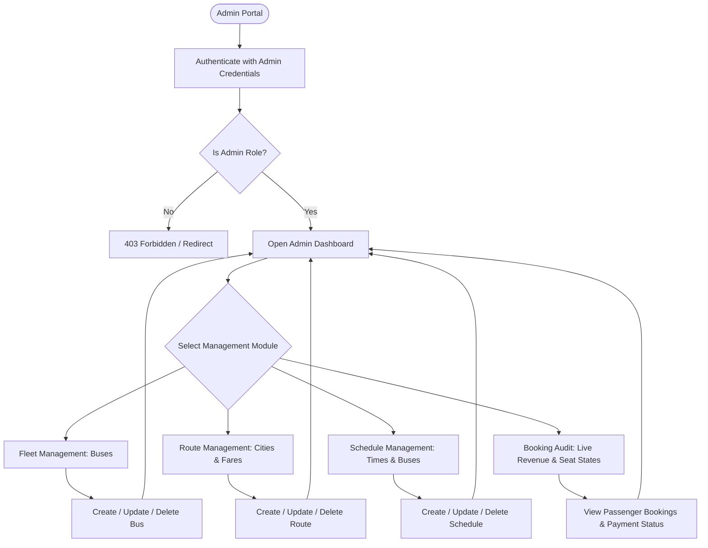
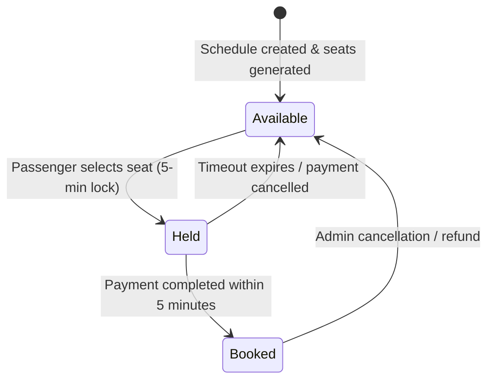
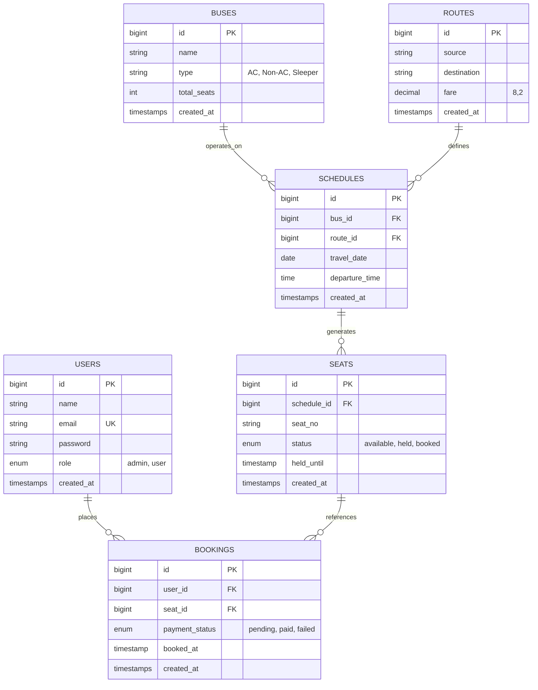

# 🚌 Smart Bus Seat Booking System

[](https://laravel.com)
[](https://php.net)
[](https://tailwindcss.com)
[](https://www.mysql.com)
[](https://vitejs.dev)

A modern, full-stack web reservation platform built with **Laravel (PHP)** and **MySQL**. The system is engineered to manage bus fleets, routes, schedules, seat inventories, and reservations. To prevent double-booking and seat hogging, the platform features a **5-minute temporary seat hold** mechanism that automatically releases unconfirmed seats back into the available pool if payment is not completed before timeout.

---

## 📌 Project Objectives

- **Schedule & Availability Discovery:** Enable passengers to search routes and view real-time seat availability.
- **Interactive Seat Selection:** Allow passengers to pick seats through an intuitive visual bus layout.
- **Race Condition & Double-Booking Prevention:** Implement a concurrency-safe temporary seat locking mechanism (5-minute hold).
- **Fleet & Route Administration:** Provide administrative controls for buses, routes, schedules, and active reservations.
- **E-Tickets with QR Verification:** Generate print-ready booking confirmation passes with dynamic QR codes.
- **Relational Integrity:** Maintain relational data constraints using Laravel's Eloquent ORM and MySQL.

---

## 🛠️ Technology Stack

| Layer | Technology | Description |
| :--- | :--- | :--- |
| **Backend Framework** | Laravel 11 (PHP 8.2+) | MVC architecture, Eloquent ORM, Artisan CLI, Middleware |
| **Database** | MySQL | Relational data storage with foreign key cascades & transactions |
| **Frontend UI** | Blade + Tailwind CSS | Responsive, accessible server-rendered views with Tailwind styling |
| **Asset Bundler** | Vite | Ultra-fast asset compilation and hot reloading |
| **E-Ticket QR Code** | SimpleSoftwareIO / QrCode | Real-time QR code generation for verified e-tickets |
| **Task Automation** | Laravel Scheduler & Artisan | Scheduled command to auto-expire orphaned seat holds |

---

## 🏗️ 1. System Architecture (Laravel MVC)



### Architectural Layers
- **Presentation Layer:** Blade templates styled with modern Tailwind CSS, delivering dynamic and mobile-responsive views.
- **Application Layer:** Route definitions, role-based authorization middleware (`admin`), request validation, and business logic controllers.
- **Data Layer:** Eloquent models with strongly defined relationships (`hasMany`, `belongsTo`), migrations, and MySQL database tables.

---

## 🔄 2. Request–Response Flow



---

## ⏱️ 3. Concurrency-Safe 5-Minute Seat Hold Flow

A selected seat is locked for **5 minutes**. If the checkout process is not completed within this window, the seat is automatically recycled back to the available state.



### Booking Logic Pseudocode
```text
1. User selects a schedule and seat number.
2. BEGIN TRANSACTION:
     Lock row for target seat.
     If seat.status == 'available' OR (seat.status == 'held' AND seat.held_until < CURRENT_TIME):
         seat.status = 'held'
         seat.held_until = CURRENT_TIME + 5 MINUTES
         seat.held_by_user_id = auth.user.id
         COMMIT TRANSACTION
         Redirect to /payment/{seat_id}
     Else:
         ROLLBACK TRANSACTION
         Return error: "Seat is no longer available."
3. User submits payment:
     If CURRENT_TIME <= seat.held_until:
         seat.status = 'booked'
         Create Booking record (payment_status = 'paid')
         Generate QR Code & E-Ticket
     Else:
         seat.status = 'available'
         Return error: "Payment session expired. Please reselect your seat."
```

---

## 👤 4. Passenger User Journey



---

## 🛡️ 5. Admin Management Workflow



---

## 🏷️ 6. Seat Status State Machine



- `available` (Green): Seat is free and selectable by any passenger.
- `held` (Yellow/Orange): Temporarily reserved by a specific user undergoing payment.
- `booked` (Red/Gray): Confirmed booking with recorded payment and issued ticket.

---

## 🗄️ 7. Entity-Relationship (ER) Diagram



---

## 📋 8. Database Schema Reference

| Table | Column | Type | Constraints / Description |
| :--- | :--- | :--- | :--- |
| **`users`** | `id` | `BIGINT` | Primary Key, Auto Increment |
| | `name` | `VARCHAR(100)` | Passenger or Administrator Name |
| | `email` | `VARCHAR(100)` | Unique, Used for Authentication |
| | `password` | `VARCHAR(255)` | BCRYPT hashed password |
| | `role` | `ENUM('user','admin')` | Default `'user'`. Controls admin middleware access |
| | `created_at` / `updated_at` | `TIMESTAMP` | Record timestamps |
| **`buses`** | `id` | `BIGINT` | Primary Key, Auto Increment |
| | `name` | `VARCHAR(100)` | Bus Fleet Name / Number (e.g. Royal Express) |
| | `type` | `VARCHAR(50)` | Fleet category: `AC`, `Non-AC`, `Sleeper` |
| | `total_seats` | `INT` | Total seat capacity (default 20/40) |
| **`routes`** | `id` | `BIGINT` | Primary Key, Auto Increment |
| | `source` | `VARCHAR(100)` | Origin departure city (e.g. Mumbai) |
| | `destination` | `VARCHAR(100)` | Terminal destination city (e.g. Pune) |
| | `fare` | `DECIMAL(8,2)` | Standard ticket price in INR / currency units |
| **`schedules`** | `id` | `BIGINT` | Primary Key, Auto Increment |
| | `bus_id` | `BIGINT` | Foreign Key referencing `buses.id` (CASCADE) |
| | `route_id` | `BIGINT` | Foreign Key referencing `routes.id` (CASCADE) |
| | `travel_date` | `DATE` | Scheduled date of departure |
| | `departure_time` | `TIME` | Scheduled time of departure |
| **`seats`** | `id` | `BIGINT` | Primary Key, Auto Increment |
| | `schedule_id` | `BIGINT` | Foreign Key referencing `schedules.id` (CASCADE) |
| | `seat_no` | `VARCHAR(10)` | Assigned seat identifier (e.g., A1, A2, B1) |
| | `status` | `ENUM('available','held','booked')` | Current seat availability status |
| | `held_until` | `TIMESTAMP NULL` | Expiration time for 5-minute hold |
| **`bookings`** | `id` | `BIGINT` | Primary Key, Auto Increment |
| | `user_id` | `BIGINT` | Foreign Key referencing `users.id` |
| | `seat_id` | `BIGINT` | Foreign Key referencing `seats.id` |
| | `payment_status` | `ENUM('pending','paid','failed')` | Payment confirmation state |
| | `booked_at` | `TIMESTAMP` | Timestamp when booking was finalized |

---

## ⚡ 9. Default Demo Credentials

The database seeder automatically configures ready-to-test accounts:

| Role | Email Address | Password | Permissions |
| :--- | :--- | :--- | :--- |
| **Administrator** | `admin@busgo.com` | `password123` | Full access to `/admin` dashboard, buses, routes, schedules & bookings |
| **Backup Admin** | `admin@bus.test` | `password123` | Secondary administrator access |
| **Passenger User** | `user@busgo.com` | `password123` | Standard booking, seat selection, checkout & ticket access |
| **Local Passenger**| `user@bus.test` | `password123` | Secondary test passenger |

---

## 🚀 10. Installation & Local Setup

### System Prerequisites
- **PHP:** 8.2 or higher (with `pdo_mysql`, `mbstring`, `openssl`, `bcmath`, `xml`, `gd` extensions enabled)
- **Composer:** Dependency manager for PHP
- **MySQL:** 8.0+ or MariaDB 10.4+
- **Node.js & npm:** Node 18+ for Vite and Tailwind CSS
- **Git**

---

### Step 1: Clone the Repository
```bash
git clone https://github.com/buildwithneel/WDF-Project.git
cd WDF-Project
```

### Step 2: Install Dependencies
```bash
# Install PHP backend dependencies
composer install

# Install Frontend dependencies
npm install
```

### Step 3: Configure Environment Variables
```bash
# Create local environment file from example
cp .env.example .env

# Generate unique application cryptographic key
php artisan key:generate
```

Open `.env` in your code editor and verify database connection settings:
```env
DB_CONNECTION=mysql
DB_HOST=127.0.0.1
DB_PORT=3306
DB_DATABASE=busbooking
DB_USERNAME=root
DB_PASSWORD=
```
*(Ensure the MySQL database named `busbooking` is created in MySQL/phpMyAdmin beforehand: `CREATE DATABASE busbooking;`)*

### Step 4: Run Migrations and Seed Demo Data
```bash
php artisan migrate --seed
```
*This command creates all database tables and seeds demo buses, routes, schedules, seats, and user accounts.*

### Step 5: Compile Frontend Assets
In a separate terminal window:
```bash
npm run dev
```
*(Or compile for production using `npm run build`)*

### Step 6: Start Laravel Development Server
```bash
php artisan serve
```
Open your browser and navigate to: **`http://127.0.0.1:8000`**

### Step 7: (Optional) Automatic Seat Expiry Daemon
To test background expiration of held seats automatically:
```bash
# Run the expired seat cleaner command once:
php artisan seats:release-expired

# Or keep the scheduler runner active:
php artisan schedule:work
```

---

## 📁 11. Project Directory Structure

```text
WDF-Project/
├── app/
│   ├── Console/Commands/
│   │   └── ReleaseExpiredSeats.php     # Scheduled command to release timed-out holds
│   ├── Http/
│   │   ├── Controllers/
│   │   │   ├── Admin/                  # Admin controllers (Buses, Routes, Schedules, Dashboard)
│   │   │   ├── Auth/                   # Login, Register, Session controllers
│   │   │   ├── BookingController.php   # Booking creation & checkout processing
│   │   │   ├── PaymentController.php   # Mock payment verification & order finalization
│   │   │   ├── SearchController.php    # Bus schedule & route search
│   │   │   ├── SeatController.php      # Seat map display & 5-minute hold locking
│   │   │   └── TicketController.php    # Confirmed ticket view with QR Code
│   │   └── Middleware/
│   │       └── AdminMiddleware.php     # Role check protecting /admin routes
│   └── Models/
│       ├── Booking.php                 # Booking Eloquent model
│       ├── Bus.php                     # Bus fleet model
│       ├── Route.php                   # Route source/destination/fare model
│       ├── Schedule.php                # Departure timetable model
│       ├── Seat.php                    # Seat state & held_until model
│       └── User.php                    # User identity & role model
├── database/
│   ├── migrations/                     # Schema definition migrations
│   └── seeders/DatabaseSeeder.php      # Full test data & demo user seeder
├── resources/
│   ├── css/app.css                     # Tailwind CSS entrypoint
│   ├── js/app.js                       # Frontend JavaScript entrypoint
│   └── views/
│       ├── admin/                      # Admin dashboard & management views
│       ├── auth/                       # Login & Registration views
│       ├── bookings/                   # Passenger reservation history
│       ├── layouts/                    # App & Auth layout wrappers
│       ├── payment/                    # Mock payment checkout screen
│       ├── search/                     # Schedule search and results
│       ├── seats/                      # Visual seat map & seat tiles
│       └── ticket/                     # Verified E-ticket with QR code
├── routes/
│   ├── auth.php                        # Authentication routes
│   ├── console.php                     # Scheduler commands definition
│   └── web.php                         # Core web application routes
├── tests/
│   └── Feature/                        # Automated Feature tests (Auth, SeatBooking, Payment)
├── .env.example                        # Template environment configurations
├── .gitignore                          # Git ignore definitions
├── composer.json                       # PHP dependencies & autoloading
├── package.json                        # Node dependencies & build scripts
└── vite.config.js                      # Vite asset bundler configuration
```

---

## 👥 12. Project Information & Authors

- **Course:** Web Development Framework (WDF)
- **Batch:** A
- **Architecture:** MVC (Model–View–Controller)

### Team Members
- **Neel Agrawal** — `25DIT002`

---

## 📄 License
This project is developed for academic, educational, and evaluation purposes under the Web Development Framework coursework.
